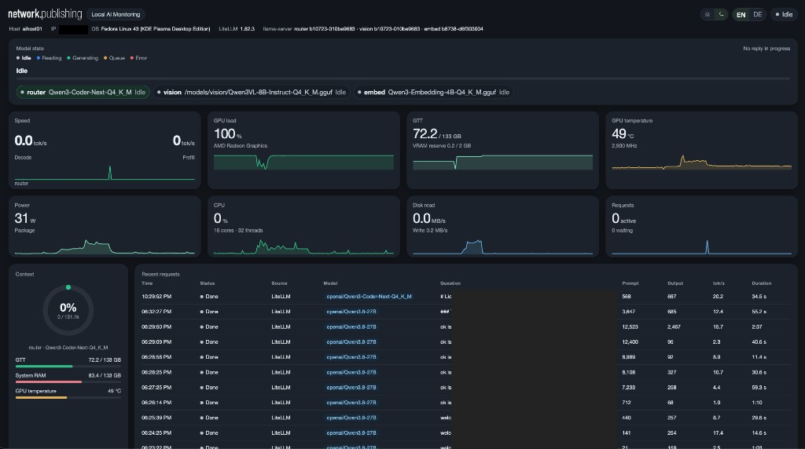

# Local AI Monitoring

A web dashboard for an AMD Strix Halo host that runs local LLMs with llama-server. It shows at a glance which requests are running, how many are waiting, and how busy the machine is.



## What it shows

- Which models are loaded on each llama-server, and whether each one is idle, reading a prompt, or generating.
- Requests in progress and requests waiting in the queue.
- Recent requests with the question, model, token counts, speed, and duration.
- CPU, GPU load, GTT memory, temperature, power, and disk activity.
- Hostname, IP address, operating system, and the LiteLLM and llama-server versions.

The interface is in English or German, in light or dark mode.

## How it gets the data

Live requests come from llama-server's `/slots` and `/metrics` endpoints. Hardware values come from `/proc` and the amdgpu files in `/sys`.

Finished requests that went through LiteLLM come from LiteLLM's own log table, `LiteLLM_SpendLogs`. The dashboard only reads that table and never writes to it. It does not keep a second copy of those prompts.

Requests sent straight to llama-server, bypassing LiteLLM, never reach that table. The dashboard keeps a short list of those in its own SQLite file.

On Strix Halo, models live in GTT, the system memory the GPU shares. The VRAM figure is only the small reserve set in the BIOS and is labeled that way.

## Requirements

- llama-server started with `--slots` and `--metrics`:

  ```bash
  llama-server --slots --metrics -m /models/model.gguf --host 127.0.0.1 --port 8080
  ```

- Optional: LiteLLM with its database in Postgres or SQLite, for finished requests and user names.
- Podman on the host. A reverse proxy such as nginx in front, because the dashboard has no login of its own.

A llama-server in router mode serves several models from one port. The dashboard asks it only about models that are already loaded, and it never makes the router load or wake a model.

## Configuration

Start from the example:

```bash
cp config.example.yaml config.yaml
```

Under `backends`, list each llama-server with a `name` and its base URL, without `/v1`:

```yaml
backends:
  - name: router
    url: http://127.0.0.1:8081
  - name: vision
    url: http://127.0.0.1:8082
```

Router mode needs nothing more; the dashboard reads the loaded models from the server. For a server that runs a single model, you can add `model` with the name LiteLLM uses for it. That helps match a live request with its LiteLLM log entry when the names differ.

`litellm_database_url` points to the LiteLLM database. Use a Postgres user with read-only rights, or a SQLite path such as `sqlite:////path/to/litellm.db`. `litellm_url` is the LiteLLM proxy address and is only used to show its version.

`direct_history_path` is the SQLite file for requests that bypass LiteLLM. The dashboard creates it. In the container, set it to `/data/direct.sqlite`.

`language` sets the default interface language, `en` or `de`. Each visitor can switch in the header, and the browser remembers the choice. The light and dark switch works the same way. Without a saved choice, the page follows the browser setting.

To add a language, copy `web/src/i18n/en.ts` to a new file such as `fr.ts`, translate it, and register it in `web/src/i18n/index.tsx`. The header then offers it.

## Run it on the Strix Halo host

Build the image and install it as a rootless Podman Quadlet:

```bash
podman build -t localhost/halo-dash:latest -f Containerfile .
mkdir -p ~/.config/halo-dash ~/.local/share/halo-dash
cp config.example.yaml ~/.config/halo-dash/config.yaml
cp deploy/halo-dash.container ~/.config/containers/systemd/halo-dash.container
systemctl --user daemon-reload
systemctl --user start halo-dash
```

Edit `~/.config/halo-dash/config.yaml` before the start. The dashboard then listens on port 8787.

The container shares the host's network and process list, so it can reach llama-server on localhost and see the real CPU load. It mounts `/sys` read-only for the GPU values, and the host's `/etc/os-release` and `/etc/hostname` so it shows the machine instead of the container. If LiteLLM uses SQLite, add that directory as another `Volume` line in the Quadlet.

After an update, rebuild the image and run `systemctl --user restart halo-dash`.

## Put it behind nginx

Copy the `location` block from `deploy/nginx.conf.example` into your nginx and add your existing authentication there. The block turns off buffering so live updates arrive right away.

On the Strix Halo host, open port 8787 only for the nginx machine:

```bash
sudo firewall-cmd --permanent --add-rich-rule='rule family="ipv4" source address="NGINX_IP" port port="8787" protocol="tcp" accept'
sudo firewall-cmd --reload
```

## Try it without a Strix Halo

With Python 3.11 or newer and Node.js, the dashboard runs on any machine with sample data:

```bash
python3 -m venv .venv
.venv/bin/pip install -e ".[dev]"
cd web && npm install && npm run build && cd ..
HALO_FIXTURES=1 .venv/bin/halo-dash
```

Then open `http://127.0.0.1:8787`.

Changes are listed in [CHANGELOG.md](CHANGELOG.md).

## License

Copyright (C) 2026 network.publishing Möller-Westbunk GmbH. Author: Christoph Möller <hallo@network-publishing.de>. Licensed under the GNU Affero General Public License v3.0. See `LICENSE`.
